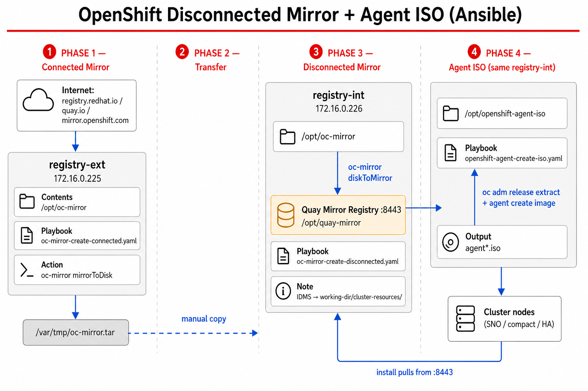

# ansible_oc-mirror

Ansible roles and playbooks for a **disconnected OpenShift** workflow: mirror
release and operator content with **oc-mirror v2**, populate an internal
**CNCF Distribution** registry, then build an **Agent-based Installer** ISO
from that mirror.

## Architecture



| Phase | Playbook | Host | What it does |
|-------|----------|------|--------------|
| 1 — Connected | `playbooks/oc-mirror-create-connected.yaml` | `registry-ext` | `oc-mirror` mirrorToDisk into `/opt/oc-mirror`, save the registry image, archive to `/var/tmp/oc-mirror.tar` |
| 2 — Transfer | (manual) | ext → int | Copy the archive to the disconnected host |
| 3 — Disconnected | `playbooks/oc-mirror-create-disconnected.yaml` | `registry-int` | Install Distribution on `:8443` if needed, then diskToMirror into the registry |
| 4 — Agent ISO | `playbooks/openshift-agent-create-iso.yaml` | `registry-int` | Extract installer from the mirrored release, render configs, produce `agent*.iso` |

Cluster nodes boot the ISO and pull install images from the internal registry.

## Roles

### [`oc-mirror`](roles/oc-mirror/README.md)

Two-phase **oc-mirror v2** mirroring for connected and disconnected environments.

- **Connected** — Download OpenShift release content (and operators / additional images from the ImageSet) to disk, save the CNCF Distribution image, and pack a transfer archive.
- **Disconnected** — Install the Distribution registry as a Podman systemd unit when it is not already healthy, restore the workspace from the archive if needed, and push content with diskToMirror.

Inventory groups `connected_mirror` and `disconnected_mirror` are children of `oc_mirror` and share `group_vars/oc_mirror.yml`.

### [`openshift-agent-iso`](roles/openshift-agent-iso/README.md)

Build an OpenShift **Agent-based Installer** ISO from the populated disconnected mirror.

- Log in to the mirror and build a mirror-only pull secret.
- Load ImageDigestMirrorSet (IDMS) and the mirror TLS trust bundle for `install-config.yaml`.
- Extract `openshift-install` with `oc adm release extract --idms-file=...`.
- Render `install-config.yaml` and `agent-config.yaml` (NMState networking, bonds/VLANs, machineNetwork from host `role: node`).
- Run `openshift-install agent create image`.

Requires a completed disconnected mirror (registry content + oc-mirror IDMS under `/opt/oc-mirror/working-dir/cluster-resources/`). Cluster inputs live in `group_vars/openshift_agent_iso.yml`.

## Prerequisites

Bare minimum to run the playbooks from a laptop or jump host (the *control
node*). You do not need to install OpenShift clients on the control node; the
roles download `oc` / `oc-mirror` onto the target hosts.

### Control node (where you run `ansible-playbook`)

| Requirement | Notes |
|-------------|--------|
| Ansible 2.14+ (`ansible-core`) | On RHEL/Fedora: `dnf install ansible-core`. Confirm with `ansible --version`. |
| Python 3 on the control node | Ships with Ansible packages on RHEL/Fedora. |
| Git + this repository cloned | Run commands from the repo root so `ansible.cfg` and relative paths resolve. |
| Ansible collections from `requirements.yaml` | Installed once with `ansible-galaxy` (see [Quick start](#quick-start)). |
| SSH key access to the target hosts | Passwordless `sudo` (or equivalent) for the inventory user is expected. |

Ansible terms used below:

- **Inventory** — list of hosts and groups (`inventory.yaml`). Edit hostnames,
  IPs, `ansible_user`, and SSH key paths to match your lab.
- **Playbook** — a YAML file under `playbooks/` that says which hosts to
  target and which role tasks to run.
- **Extra vars / vault** — secrets passed on the command line with
  `--extra-vars @vault/….yaml`. Encrypted with `ansible-vault` so they are
  not stored in plaintext in git.
- **Vault password file** — a local file Ansible reads to decrypt vault
  content. Keep it outside the repo (for example `/path/to/.vault_password`)
  and never commit it.

### Target hosts

| Host role | Inventory group | Needs |
|-----------|-----------------|--------|
| Connected mirror | `connected_mirror` | Internet access, large disk under `/opt` and `/var/tmp` (often 200+ GiB for a full release mirror) |
| Disconnected mirror | `disconnected_mirror` | Same disk sizing; Podman; no internet required after the transfer archive (and registry image) are present |
| Agent ISO | `openshift_agent_iso` | Usually the same host as `disconnected_mirror` |

Edit `inventory.yaml` before the first run: replace the example hostnames /
IPs and set `ansible_user` plus `ansible_ssh_private_key_file`. Groups
`connected_mirror` and `disconnected_mirror` are children of `oc_mirror` and
share `group_vars/oc_mirror.yml`.

### Accounts and files you must supply

1. A Red Hat OpenShift **pull secret** from
   [console.redhat.com](https://console.redhat.com/openshift/downloads#tool-pull-secret)
   (JSON file).
2. A **registry username and password** you choose for the internal
   Distribution registry (htpasswd basic auth).
3. An SSH **public key** for cluster nodes when building the Agent ISO
   (`openshift_ssh_key`).
4. Optional: custom ingress TLS PEMs in `vault/ingress_tls_secrets.yaml`
   (can be empty / unused until post-install).

## Quick start

Work from the repository root. Pass every file under `vault/` with
`--extra-vars` on each playbook run. See each role README for the full
variable list.

### 1. Install Ansible collections

```bash
ansible-galaxy collection install -r requirements.yaml
```

Collections land under `~/.ansible/collections` (see `ansible.cfg`). Re-run
this after cloning on a new machine.

### 2. Confirm SSH to the targets

```bash
ansible connected_mirror,disconnected_mirror \
  --inventory inventory.yaml \
  --module-name ping
```

Fix inventory or SSH keys until both hosts return `pong`.

### 3. Create a vault password file

Pick a strong password and store it outside the git tree:

```bash
echo "${VAULT_PASSWORD}" > /path/to/.vault_password
chmod 600 /path/to/.vault_password
```

### 4. Encrypt secrets into `vault/`

Download the pull secret, then encrypt it (adjust the JSON path):

```bash
ansible-vault encrypt_string --vault-password-file /path/to/.vault_password \
  --name redhat_pull_secret "$(cat /tmp/pull_secret.json)" \
  --output vault/redhat_secrets.yaml
```

Encrypt registry credentials (choose any username/password the lab will use):

```bash
ansible-vault encrypt_string --vault-password-file /path/to/.vault_password \
  --name registry_user "${REGISTRY_USER}" \
  --output vault/registry_secrets.yaml
ansible-vault encrypt_string --vault-password-file /path/to/.vault_password \
  --name registry_password "${REGISTRY_PASSWORD}" \
  --output vault/registry_secrets.yaml
```

`vault/ingress_tls_secrets.yaml` is optional for the mirror steps; include it
in `--extra-vars` anyway so all playbooks use the same command shape. Add
encrypted ingress PEMs later when you need custom default ingress TLS.

### 5. Run the workflow

```bash
# 1. Connected mirror (internet-facing host)
ansible-playbook playbooks/oc-mirror-create-connected.yaml \
  --inventory inventory.yaml \
  --extra-vars @vault/redhat_secrets.yaml \
  --extra-vars @vault/registry_secrets.yaml \
  --extra-vars @vault/ingress_tls_secrets.yaml \
  --vault-password-file /path/to/.vault_password

# 2. Copy /var/tmp/oc-mirror.tar from registry-ext to registry-int
#    (skip if both hosts share the archive path, for example via virtiofs)

# 3. Disconnected mirror (internal registry host)
ansible-playbook playbooks/oc-mirror-create-disconnected.yaml \
  --inventory inventory.yaml \
  --extra-vars @vault/redhat_secrets.yaml \
  --extra-vars @vault/registry_secrets.yaml \
  --extra-vars @vault/ingress_tls_secrets.yaml \
  --vault-password-file /path/to/.vault_password

# 4. Agent ISO (also set cluster inputs in group_vars/openshift_agent_iso.yml)
ansible-playbook playbooks/openshift-agent-create-iso.yaml \
  --inventory inventory.yaml \
  --extra-vars @vault/redhat_secrets.yaml \
  --extra-vars @vault/registry_secrets.yaml \
  --extra-vars @vault/ingress_tls_secrets.yaml \
  --extra-vars openshift_ssh_key="$(cat ~/.ssh/id_ed25519.pub)" \
  --vault-password-file /path/to/.vault_password
```

Useful flags while learning Ansible:

- `--limit <hostname>` — run against one inventory host only
- `--check` — dry-run where modules support it (not a full substitute for a
  real mirror run)
- `-v` / `-vv` — more logging

## Further reading

- [oc-mirror role](roles/oc-mirror/README.md) — paths, ImageSet variables, registry install, archive transfer
- [openshift-agent-iso role](roles/openshift-agent-iso/README.md) — topology rules, networking, IDMS extract, ISO outputs
- [Ansible User Guide](https://docs.ansible.com/ansible/latest/user_guide/index.html) — inventory, playbooks, vault
